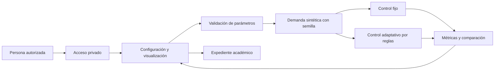
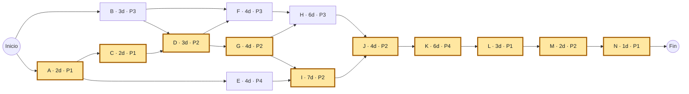

# Sistema inteligente de gestión de tráfico vehicular en CDMX

## Naturaleza y objetivo

Este expediente reúne una **propuesta académica para un equipo de cuatro personas** y los criterios para validar el prototipo web. El plan no es un registro de semanas ya trabajadas ni una autorización de operación vial. El documento adjunto *Ingeniería de Software para Sistemas Inteligentes*, de 35 páginas, se utiliza como material de referencia; sus ejercicios no constituyen instrucciones de ejecución del proyecto.

El objetivo es permitir que una persona configure demanda y tiempos de un cruce representativo en CDMX, compare una estrategia fija con otra adaptativa y observe sus efectos sobre circulación y colas mediante experimentos reproducibles. El resultado será un prototipo privado con evidencia de pruebas, supuestos visibles y documentación suficiente para extenderlo.

Los nombres de zonas o corredores sirven para contextualizar escenarios. **No acreditan calibración para un cruce real, aforos de campo ni acceso a Waze.** No se identifica una ruta como la más congestionada de CDMX a partir de datos sintéticos. La simulación no envía órdenes a semáforos físicos.

### Alcance de esta entrega

- Una intersección simplificada con dos ejes incompatibles, norte-sur y este-oeste, y dos fases.
- Ajuste de demanda, ciclo y reparto inicial de verde, con validación de parámetros.
- Comparación de control fijo y adaptativo bajo las mismas llegadas y semilla.
- Visualización de los cambios de verde, colas, vehículos atendidos y demora observada.
- Explicación de supuestos, metodología, requisitos, factibilidad, riesgos, PERT y cronograma.
- Acceso privado y comprobación del rechazo a personas sin autenticar.

Quedan fuera de alcance: coordinación de una red de cruces, ingeniería de seguridad de un controlador físico, permisos de autoridades, operación en vía pública, calibración de aforos, acceso confirmado a un proveedor vial y entrenamiento de deep learning. Incorporarlos requeriría otro alcance y un estudio formal.

## Actores y sistema

| Actor | Necesidad dentro del proyecto | Relación con el sistema |
| --- | --- | --- |
| Analista académico | Formular hipótesis sobre demanda y tiempos | Configura, ejecuta y compara escenarios |
| Evaluador o docente | Revisar coherencia y evidencia | Consulta métricas, supuestos, pruebas y expediente |
| Equipo de cuatro | Construir y mantener el prototipo | Gestiona backlog, revisiones, configuración y documentación |
| Responsable del entorno privado | Controlar quién puede consultar el prototipo | Administra credenciales y vigencia del servicio |
| Autoridad vial potencial | Evaluar una futura investigación | No se asume participante ni autoriza esta entrega |

Las entradas son demanda sintética por eje, tiempos, horizonte y semilla. El procesamiento comprende generación de llegadas, actualización de colas, cambios de fase y acumulación de métricas. Las salidas son series temporales y comparaciones. La retroalimentación consiste en cambiar parámetros y repetir el experimento. El límite del sistema termina en la simulación y su visualización, como exige delimitar las notas en pp. 1, 5 y 34.



El motor usa llegadas Poisson generadas por segundo con semilla, iguales para ambas estrategias. Cada eje representa un carril equivalente con saturación supuesta de 1 800 vehículos/hora durante el verde. Por fase hay cinco segundos de despeje modelados completamente como todo rojo y sin servicio; no se representa un ámbar separado. El ciclo total es `verde_NS + verde_EW + 10 s`.

La estrategia fija conserva el reparto configurado. La adaptativa comparte el primer ciclo con la fija y, desde el segundo, revisa la demanda observada y las colas para reasignar el verde, con límites de 15–75 segundos por eje y la misma suma total de verdes. Actualiza una media móvil exponencial de demanda con peso 0.5 para el último ciclo. El peso de cada eje es su cola más la demanda estimada durante un ciclo. El verde norte-sur se redondea proporcionalmente a esos pesos y se acota para que ambos verdes cumplan sus límites; el restante corresponde a este-oeste. No anticipa llegadas futuras. Es una política explicable basada en datos simulados; **no es un modelo de aprendizaje automático entrenado**. La definición ejecutable se mantiene en `public/simulation.js`.

La demora observada por llegada se calcula como la integral de las colas dividida entre el número de llegadas, en segundos/vehículo. Incluye únicamente la espera acumulada durante el horizonte: los vehículos que permanecen en cola tienen observación censurada y podrían esperar más después. No representa tiempo de viaje, velocidad de circulación ni una demora completa de todos los viajes. El caudal de salida se expresa en vehículos/hora. El escenario puede estar sobresaturado y acumular cola aunque se adapte el reparto.

No se representan peatones, transporte público, giros, bloqueo entre cruces, prioridad de emergencias, conducción individual ni geometría real. Los intervalos usados son supuestos del simulador, no recomendaciones de seguridad vial para CDMX. Una mejora en esta simulación no prueba una mejora de la ciudad.

## Metodología para cuatro personas

Se propone **Scrum ligero para coordinar entregas, complementado con CRISP-DM para el trabajo de datos**. Es una adaptación educativa; no se afirma implementar íntegramente Scrum oficial. Las notas describen Scrum, backlog y seguimiento diario en p. 4, y piden tener una metodología presente en el cronograma en pp. 7–8.

Cuatro sprints de dos semanas permiten revisar un incremento antes de comprometer más esfuerzo. Un tablero Por hacer → En curso → Revisión → Terminado hace visible el trabajo, con una tarea principal por persona y revisión por otro integrante. La reunión diaria dura diez minutos; se registran avances, siguiente paso y bloqueos. Cada sprint tiene planificación, revisión con demostración y retrospectiva. Producto mantiene prioridades; la facilitación de reuniones rota entre los integrantes, sin crear un quinto puesto.

CRISP-DM complementa la coordinación con seis preguntas: entender el problema, entender datos, prepararlos, modelar, evaluar y desplegar. En esta primera versión, modelar significa construir y verificar la simulación y los controladores. No obliga a usar una red neuronal. La evaluación puede llevar a revisar los supuestos o a preferir el control fijo.

La elección favorece retroalimentación frecuente y poca carga de coordinación para cuatro personas. Un proceso predictivo completo exigiría estabilizar requisitos que aún dependen de pruebas. Crystal o Kanban también serían razonables; Kanban se conserva como herramienta visual dentro de los sprints. CRISP-DM por sí solo no organiza todas las entregas de software; Scrum por sí solo no documenta la validez de los datos. No se promete que una metodología sea siempre la más rápida.

| Persona propuesta | Responsabilidad principal | Entregables y decisiones |
| --- | --- | --- |
| P1 · Producto y análisis | Alcance, factibilidad, aceptación | Backlog priorizado, riesgos, acuerdos, expediente y cierre |
| P2 · Ingeniería web | Arquitectura, interfaz e integración | Aplicación, acceso privado, configuración y revisión final |
| P3 · Datos y simulación | Supuestos, generador y adaptación | Diccionario de datos, motor, escenarios y experimentos |
| P4 · Calidad y experiencia | UX, accesibilidad y validación | Prototipo visual, plan de pruebas, defectos y evidencias |

Son roles propuestos porque no se proporcionaron nombres ni disponibilidades. Todos pueden revisar trabajo ajeno. Una revisión o reunión se programa fuera del bloque de una tarea principal; no se considera capacidad infinita ni se divide la duración del proyecto entre cuatro.

### Fases y artefactos

| Fase de gestión | Actividades | Artefactos | Relación CRISP-DM |
| --- | --- | --- | --- |
| Inicio | Definir problema, actores y límites | Objetivo, alcance y supuestos | Entendimiento del negocio |
| Planificación | Levantar y validar requisitos, estimar recursos y riesgos | Backlog, factibilidad, matriz de riesgos, PERT y Gantt | Entendimiento y preparación de datos |
| Desarrollo | Diseñar arquitectura, UX, simulación y controladores | Diseño, contratos, código y escenarios | Preparación y modelado |
| Seguimiento y control | Revisar incremento, comparar resultados y corregir | Tablero, métricas, actas breves, pruebas y cambios | Evaluación e iteraciones |
| Cierre | Aceptación, manual y entrega privada | Reporte de validación, acta propuesta y pendientes | Despliegue y seguimiento |

Estas cinco fases corresponden a p. 7; análisis, diseño, pruebas, factibilidad y riesgos corresponden a p. 1. Las revisiones, solución de problemas y calidad se relacionan con p. 2. El acta y la capacitación al usuario se consideran en p. 6. Se toma ISO/IEC 12207 como referencia de procesos y trazabilidad, sin declarar una certificación ni asumir obligatoriedad universal.

## Requisitos y aceptación

La adquisición inicial se basa en la solicitud del usuario y sus notas. Falta validar con usuarios objetivo mediante una sesión guiada; no se simulan entrevistas o encuestas realizadas. Se sigue la secuencia adquisición → especificación → validación → documentación de p. 5.

| ID | Historia de usuario y prioridad | Criterios observables |
| --- | --- | --- |
| RF-01 | Como analista quiero ajustar demanda por eje para explorar congestión. Esencial. | Controles con unidades y límites; demanda identificada como sintética; misma configuración y semilla producen las mismas llegadas. |
| RF-02 | Como analista quiero configurar ciclo y verdes para comparar planes. Esencial. | Se rechazan combinaciones inválidas; verdes incompatibles no se simultanean; las fases conservan los interverdes definidos por el modelo. |
| RF-03 | Como evaluador quiero comparar estrategias bajo condiciones equivalentes. Esencial. | Mismas llegadas y horizonte; fijo conserva reparto; adaptativo explica ajustes; se reportan empates o empeoramiento. |
| RF-04 | Como usuario quiero comprender circulación y tiempos. Esencial. | Las métricas tienen unidades y horizonte; las series distinguen estrategias; no se confunde demora observada con tiempo total de viaje. |
| RF-05 | Como integrante quiero consultar la planeación y su evidencia. Esencial. | Cuatro roles y sprints; PERT con tres tiempos, dependencias y ruta crítica; referencias a páginas del PDF. |
| RNF-01 | Como propietario quiero limitar el acceso. Esencial. | Una sesión anónima no obtiene simulador ni recursos protegidos; credenciales fuera del repositorio; acceso autenticado y rechazo anónimo verificados. |
| RNF-02 | Como usuario quiero operar con teclado y pantalla pequeña. Esencial. | Etiquetas, foco visible, mensajes claros; significado no depende solo del color; revisión en móvil y escritorio. |
| RNF-03 | Como revisor quiero reproducir y verificar el modelo. Esencial. | Salidas deterministas con misma semilla; llegadas = atendidos + cola final; tiempos válidos y colas no negativas. |

La definición de terminado exige criterios de aceptación verificados, revisión de otro integrante, ausencia de defectos críticos abiertos, supuestos actualizados, instalación documentada y alcance privado conservado. La aprobación del usuario académico es una actividad futura y se registra por separado de las pruebas técnicas.

## Factibilidad

| Dimensión | Evaluación para el prototipo | Condición o límite |
| --- | --- | --- |
| Técnica: hardware | Simulación pequeña ejecutable en navegador y servidor de desarrollo, sin GPU | Medir tiempo de ejecución y memoria con el horizonte máximo permitido; no extrapolar a una red urbana |
| Técnica: software | Runtime web, interfaz, motor determinista y pruebas automatizadas | Documentar versiones y comandos; comprobar instalación y arranque desde entorno limpio |
| Técnica: servicios | No se necesita API vial para el flujo principal | Hospedaje privado requiere un servicio con control de acceso verificable; Waze no es una dependencia instalada |
| Operativa: desarrollo | Cuatro roles con revisión cruzada | Confirmar disponibilidad, conocimientos web y capacidad para analizar simulación |
| Operativa: usuario | Controles sencillos, explicación y recorrido guiado | Probar comprensión de métricas y aceptación; no se afirma que la autoridad vial lo usaría |
| Temporal | Objetivo de ocho semanas, 40 días laborables relativos | PERT base 34 días; reserva de 15% lleva a 39.1; cualquier cambio de alcance requiere reestimar |
| Económica | Viable como prototipo con infraestructura existente | Costos reales dependen de horas, tarifas y proveedor; no se conocen aún cotizaciones |
| Legal y ética | Datos sintéticos sin identificadores personales ni control físico | Para datos reales revisar autorización, licencia, privacidad y condiciones del proveedor; para operación real obtener evaluación de seguridad y permisos |

En la estimación de tareas se acumulan **51 días-persona principales**. Con el supuesto educativo de cuatro horas efectivas por día-persona, equivalen a 204 horas principales. No incluyen exhaustivamente ceremonias, revisión cruzada, capacitación ni mantenimiento. La duración de 34 días resulta de dependencias y paralelismo y no equivale a 34 días-persona.

Un presupuesto inicial parametrizable es `C_base = 204 × tarifa_hora + infraestructura + capacitación + servicios`. Puede reservarse 20% del costo base por incertidumbre económica: `C_total = 1.20 × C_base`. El 20% económico es distinto del 15% temporal. Si la tarifa fuera, solo como ejemplo, 100 MXN/h y los otros conceptos fueran 600 MXN en conjunto, el escenario daría 21 000 MXN base y 25 200 MXN con reserva. No es una cotización ni un gasto autorizado. Deben presupuestarse por separado mantenimiento, revisión vial profesional y adquisición de datos si se amplía el proyecto.

Las notas piden estas dimensiones en p. 34 y riesgos técnicos en p. 35. La referencia del PDF a «42000» es imprecisa; ISO/IEC 42001 se puede estudiar como estándar de gestión de IA, sin dar por hecho certificación, obligación legal o cumplimiento. La revisión normativa de un despliegue vial real sigue pendiente.

## Riesgos y respuesta

Las probabilidades e impactos son juicios iniciales cualitativos, no frecuencias históricas.

| ID | Riesgo | Probabilidad / impacto | Prevención y contingencia | Responsable |
| --- | --- | --- | --- | --- |
| R1 | No obtener datos reales autorizados | Alta / Alto | Usar demanda sintética desde el inicio. Mantener el modo simulado si el convenio o licencia no llega. | P3 |
| R2 | Interpretar resultados como órdenes para vía pública | Media / Muy alto | Mostrar límites; excluir conexiones físicas. Detener cualquier ampliación operativa hasta autorización y evaluación profesional. | P1 |
| R3 | Comparación que favorezca al adaptativo | Media / Alto | Mismas llegadas, varias semillas y cargas. Publicar dentro del entorno privado también regresiones y empates. | P4 |
| R4 | Exposición no autorizada | Media / Alto | Acceso obligatorio, secretos fuera del repositorio y prueba anónima. Cerrar acceso si falla la autenticación. | P2 |
| R5 | Retraso por integración o exceso de alcance | Media / Alto | Integrar temprano, priorizar un cruce y reservar 15%. Reordenar backlog y reestimar; ML no bloquea entrega. | P1 |
| R6 | Demanda superior a capacidad | Alta / Medio | Mostrar cola acumulada y saturación. Explicar que ajustar verdes no crea capacidad ilimitada. | P3 |
| R7 | Incompatibilidad o instalación fallida | Media / Medio | Versiones y comandos reproducibles, pruebas de arranque y verificación de integridad. Corregir la causa sin desactivar TLS ni firmas. | P2 |
| R8 | Interfaz difícil de entender | Media / Medio | Etiquetas, teclado, contraste y prueba guiada. Corregir barreras antes de aceptación. | P4 |

Revisar la matriz al inicio y cierre de cada sprint. Registrar disparador, medida aplicada y cambio de estimación cuando se materialice un riesgo. Los porcentajes de reserva son decisiones del plan, no resultados estadísticos de esta matriz.

## PERT y CPM calculados

Las estimaciones siguientes son hipótesis del equipo por confirmar, expresadas en **días laborables**. No se han copiado las duraciones de los ejercicios del PDF. El origen es día 0; el intervalo `[0,2)` corresponde a los primeros dos días de trabajo. No se fijan fechas calendario porque no se proporcionó fecha de inicio ni vacaciones.

Para una actividad, `te = (To + 4Tm + Tp) / 6`, `varianza = ((Tp − To) / 6)²`. El recorrido hacia delante calcula `ES = máximo(EF de predecesoras)` y `EF = ES + te`. El recorrido hacia atrás calcula `LF = mínimo(LS de sucesoras)` y `LS = LF − te`. La holgura total es `LS − ES = LF − EF`. Se usan actividades en nodos; no hacen falta actividades ficticias de duración cero.

| ID | Actividad | Persona | Predecesoras | To | Tm | Tp | te | Varianza | ES | EF | LS | LF | Holgura |
| --- | --- | --- | --- | ---: | ---: | ---: | ---: | ---: | ---: | ---: | ---: | ---: | ---: |
| A | Alcance y requisitos | P1 | — | 1 | 2 | 3 | 2 | 0.1111 | 0 | 2 | 0 | 2 | 0 |
| B | Datos, métricas y supuestos | P3 | — | 2 | 3 | 4 | 3 | 0.1111 | 0 | 3 | 1 | 4 | 1 |
| C | Factibilidad y riesgos | P1 | A | 1 | 2 | 3 | 2 | 0.1111 | 2 | 4 | 2 | 4 | 0 |
| D | Arquitectura y contrato del modelo | P2 | B, C | 2 | 3 | 4 | 3 | 0.1111 | 4 | 7 | 4 | 7 | 0 |
| E | Prototipo UX y accesibilidad | P4 | A | 2 | 4 | 6 | 4 | 0.4444 | 2 | 6 | 7 | 11 | 5 |
| F | Generador de demanda y escenarios | P3 | B, D | 2 | 4 | 6 | 4 | 0.4444 | 7 | 11 | 8 | 12 | 1 |
| G | Control fijo y motor base | P2 | D | 2 | 4 | 6 | 4 | 0.4444 | 7 | 11 | 7 | 11 | 0 |
| H | Control adaptativo y experimentos | P3 | F, G | 3 | 6 | 9 | 6 | 1.0000 | 11 | 17 | 12 | 18 | 1 |
| I | Interfaz y visualizaciones | P2 | E, G | 4 | 7 | 10 | 7 | 1.0000 | 11 | 18 | 11 | 18 | 0 |
| J | Integración y acceso privado | P2 | H, I | 2 | 4 | 6 | 4 | 0.4444 | 18 | 22 | 18 | 22 | 0 |
| K | Validación funcional y del modelo | P4 | J | 3 | 6 | 9 | 6 | 1.0000 | 22 | 28 | 22 | 28 | 0 |
| L | Aceptación y retroalimentación | P1 | K | 2 | 3 | 4 | 3 | 0.1111 | 28 | 31 | 28 | 31 | 0 |
| M | Ajustes y verificación final | P2 | L | 1 | 2 | 3 | 2 | 0.1111 | 31 | 33 | 31 | 33 | 0 |
| N | Manual, cierre y entrega | P1 | M | 0.5 | 1 | 1.5 | 1 | 0.0278 | 33 | 34 | 33 | 34 | 0 |

La ruta crítica es **A → C → D → G → I → J → K → L → M → N**, con duración esperada de **34 días**. Su varianza suma `3.472222 días²` y su desviación estándar es `1.863390 días`, bajo el supuesto simplificador de independencia. La convergencia de varias ramas y la incertidumbre correlacionada impiden interpretar estos valores como una garantía del plazo; no se asigna un porcentaje de confianza sin una evaluación adicional.

Se reserva `34 × 15% = 5.1 días`, por lo que la duración presupuestada es **39.1 días**, dentro del objetivo de **40 días / ocho semanas de cinco días**, con 0.9 días adicionales de margen. La reserva se mantiene separada de las duraciones de tarea; no se suma otra vez a cada actividad.



Todas las rutas del grafo desde un origen hasta N son:

| Ruta | Duración |
| --- | ---: |
| A → C → D → F → H → J → K → L → M → N | 33 |
| A → C → D → G → H → J → K → L → M → N | 33 |
| **A → C → D → G → I → J → K → L → M → N** | **34** |
| A → E → I → J → K → L → M → N | 29 |
| B → D → F → H → J → K → L → M → N | 32 |
| B → D → G → H → J → K → L → M → N | 32 |
| B → D → G → I → J → K → L → M → N | 33 |
| B → F → H → J → K → L → M → N | 29 |

## Cronograma y recursos

CPM por sí solo no resuelve conflictos de recursos. Para este plan, además se comprueba que ninguna persona tenga dos tareas principales simultáneas en el calendario temprano. La holgura técnica no se usa libremente sin volver a revisar recursos: retrasar F y H, por ejemplo, obliga a mantener su secuencia para P3.

| Persona | Intervalos de asignación principal, sin solapes |
| --- | --- |
| P1 | A [0,2), C [2,4), L [28,31), N [33,34) |
| P2 | D [4,7), G [7,11), I [11,18), J [18,22), M [31,33) |
| P3 | B [0,3), F [7,11), H [11,17) |
| P4 | E [2,6), K [22,28) |

Los intervalos sin tarea principal permiten revisión, documentación, experimentos auxiliares y atención a defectos. Esta tabla no presupone ocupación total ni productividad idéntica. Las actividades de aceptación requieren una sesión real de evaluación; su resultado no se da por aprobado en esta propuesta.

| Sprint | Ventana relativa | Objetivo y entregables | Hito |
| --- | --- | --- | --- |
| S1 | Días 0–10 / semanas 1–2 | A, B, C, D y E; alcance, riesgos, arquitectura, diccionario y prototipo. F/G iniciadas. | Diseño revisable al día 7 |
| S2 | Días 10–20 / semanas 3–4 | F, G, H e I; ambos controladores, escenarios y visualización. J iniciada. | Comparación lista para integrar al día 18 |
| S3 | Días 20–30 / semanas 5–6 | J y K; versión candidata y pruebas. L iniciada. | Evidencias de validación al día 28 |
| S4 | Días 30–40 / semanas 7–8 | L, M y N; aceptación, ajustes, manual y cierre esperado al día 34. | Reserva 5.1 días y margen 0.9 días |

Gantt relativo; cada carácter representa un día de trabajo principal desde el día 0:

```text
Día        0         10        20        30        40
           |---------|---------|---------|---------|
A · P1     ██
B · P3     ███
C · P1       ██
D · P2         ███
E · P4       ████
F · P3            ████
G · P2            ████
H · P3                ██████
I · P2                ███████
J · P2                       ████
K · P4                           ██████
L · P1                                 ███
M · P2                                    ██
N · P1                                      █
Reserva                                      ░░░░░·
```

La tabla de intervalos constituye la referencia numérica; el Gantt de texto es ilustrativo. La vista interactiva calcula las posiciones a partir de las mismas tareas. Un cambio de dependencia, tiempo o disponibilidad requiere recalcular ruta, margen, carga y compromisos de sprint.

## Plan de validación y criterios de resultado

La verificación pregunta si el sistema se construyó conforme a su especificación; la validación pregunta si sirve para el uso académico acordado, de acuerdo con la distinción en p. 6. Las comprobaciones siguientes son criterios del proyecto; los resultados efectivamente ejecutados deben registrarse con sus comandos y evidencia, sin marcar una prueba como aprobada solo por estar en este plan.

| Área | Caso significativo | Resultado esperado |
| --- | --- | --- |
| Reproducción | Repetir configuración, semilla y horizonte | Mismas llegadas, series y métricas |
| Equidad experimental | Ejecutar fija y adaptativa | Comparten llegadas y tiempo total; no se selecciona solo una semilla favorable |
| Conservación | Revisar cada eje y estrategia | Llegadas acumuladas = atendidos acumulados + cola final, dentro de tolerancia numérica |
| Demanda nula | Cero llegadas | Colas y caudal nulos; división por cero manejada y métricas comprensibles |
| Sobresaturación | Demanda que supera capacidad | Colas crecen; no se promete que el adaptativo siempre las reduzca |
| Balance y asimetría | Escenarios balanceados y un eje dominante | Se preservan límites y suma de verdes; se comparan ambos ejes y la demora agregada |
| Fases | Inspeccionar varios ciclos | No hay verde simultáneo incompatible; despeje todo rojo sin servicio en este modelo |
| Entradas | Valores fuera de rango o incompatibles | Rechazo claro; no se muestra una comparación engañosa |
| Interfaz | Teclado, móvil y escritorio | Controles utilizables, foco visible, leyendas y unidades legibles |
| Privacidad | Petición anónima y sesión autorizada | Anónima rechazada antes de recursos protegidos; autorizada funciona |
| Usabilidad | Persona objetivo ejecuta tres tareas guiadas | Configura demanda, compara y explica el origen sintético y una limitación; registrar errores observados |

No se impone como criterio que el adaptativo siempre gane. Para un informe experimental, evaluar al menos demanda baja, balanceada, asimétrica y sobresaturada, con varias semillas predefinidas y el mismo horizonte; informar dispersión y casos desfavorables. Una muestra pequeña sirve para contrastar el simulador, sin demostrar causalidad en la red vial real.

### Ampliación futura de machine learning

Primero se necesitaría un conjunto autorizado con timestamp, agregados por eje, aforo, colas o una variable objetivo utilizable, procedencia, licencia y calidad. Revisar sesgos de cobertura, periodos faltantes y cambios por obras o eventos. Waze solo sería una fuente candidata tras confirmar acceso y condiciones; sus velocidades de segmentos no equivalen automáticamente a demanda o cola de un cruce.

Una primera tarea supervisada razonable sería predecir demanda agregada a corto plazo y comparar una regresión sencilla o árboles con un pronóstico de persistencia. Separar entrenamiento, validación y prueba en orden temporal, sin filtrar futuro, y evaluar MAE de demanda junto con las métricas de control. El modelo no debe elegirse por su complejidad: deep learning requiere volumen suficiente y mejora demostrada. La política de control sigue necesitando restricciones y comparación con una línea base. La simulación sintética puede servir para ensayar un pipeline; su desempeño no demuestra generalización real.

Un cambio a refuerzo o control físico exigiría evaluación fuera de línea, entorno de pruebas de seguridad, supervisión humana y autorizaciones. No forma parte de este prototipo.

## Entrega, privacidad y mantenimiento

La entrega debe incluir aplicación, instrucciones de instalación y arranque, expediente, evidencia de pruebas y pendientes. El acta propuesta registra versión, alcance, pruebas realizadas, defectos conocidos, responsable y observaciones de quien acepta. Su firma o aceptación no se inventa. La capacitación propuesta consiste en un recorrido que explique entradas, comparación, demora censurada y límites.

La visibilidad queda limitada al propietario y personas autorizadas. Ninguna URL debe considerarse privada únicamente por ser difícil de adivinar: se necesita control de acceso comprobado. No ampliar visibilidad ni publicar sin aprobación del propietario. Las credenciales se administran por un canal seguro, no se incluyen en el código, ejemplos o expediente. La permanencia, vencimiento y disponibilidad de una URL dependen del alojamiento; se documentan al entregar y no se promete operación indefinida de un servidor de desarrollo.

Para continuidad, guardar la configuración reproducible y las versiones; ejecutar las pruebas pertinentes después de cambios al motor o a la autenticación. Cada nueva tarea utiliza el checkout aislado existente del entorno; no se crea otro worktree salvo solicitud expresa del usuario.

## Referencias al material proporcionado y discrepancias

La numeración siguiente corresponde a los pies de página del PDF adjunto, *Ingeniería de Software para Sistemas Inteligentes*.

| Páginas | Contenido de las notas | Aplicación y precisión |
| --- | --- | --- |
| 1 | Propósito de documentar análisis, diseño, pruebas, factibilidad y riesgos; límites de lo realizable | Estructura del expediente y delimitación del prototipo |
| 2 | Ciclo de vida, riesgos, calidad e ISO/IEC 12207; modelos V, espiral, incremental y prototipos | Referencia de procesos. La afirmación «Para la eficiencia en tiempo, no usamos metodologías Ágil» es contextual, no una demostración de superioridad; se justifica la elección para este equipo |
| 3–4 | SSADM y comparación de metodologías, Kanban, XP, Scrum y backlog | Coordinación ligera y tablero. CRISP-DM es una propuesta añadida a las notas. Las historias de usuario no son exclusivas de XP |
| 5 | Componentes, entradas, procesamiento, salidas, límites, requisitos y validación | Descripción del sistema, actores y trazabilidad |
| 6 | Verificación, validación, pruebas, reporte de aceptación y acta | Plan de evidencias y aceptación futura |
| 7–8 | Cinco fases de gestión; estimar actividades, dependencias, responsables y cronograma; PERT y contingencia | Planeación propia para cuatro personas. La conversión de p. 8 «20 semanas = 67200 horas» no se usa: depende de días y horas por jornada y resulta incorrecta con una jornada usual |
| 9–12 | Ejercicios y fotografías de actividades, Gantt y red para un sistema de imágenes | Se revisaron como ejemplos visuales; no son tareas ni tiempos de este proyecto |
| 13 | PERT, inicio y término temprano/tardío, holgura, ruta crítica, desviación y riesgo | Se corrige la errata «TérminoTardío − TérminoTardío»: la holgura es LF−EF o LS−ES. La desviación es (Tp−To)/6; la varianza es su cuadrado |
| 14 | Solicita Gantt, PERT, tiempo estimado, rutas y contingencia del 15% o 20% según ejercicio | Se incluyen red, tabla, ocho rutas y Gantt. Para este plan se adopta explícitamente 15% temporal |
| 15–20 | Ejercicio 1 con tabla, PERT, rutas y Gantt | Se usa la forma de presentación, con duraciones propias y cálculos independientes |
| 21–25 | Ejercicio 2 con contingencia del 15%, tablas, rutas y Gantt | Se conserva la distinción entre duración base y reserva |
| 26–30 | Ejercicio 3 y resultados con contingencia | La tabla inicial p. 26 no coincide con actividades y datos de p. 27; esta última usa 20% aunque p. 26 dice 15%. No se mezclan sus números ni se presentan como datos del proyecto |
| 31–33 | Opciones de proyectos; sistema de tráfico en CDMX, semáforos, Waze, ML/DL | Define el contexto. La mención de Waze no demuestra acceso; ML/DL no obliga a afirmar entrenamiento existente |
| 34–35 | Factibilidad legal, operativa, técnica, económica y temporal; riesgos técnicos | Cinco dimensiones y riesgos concretos. «42000» es impreciso; cualquier adopción de un estándar o cumplimiento se revisa formalmente |

Las estimaciones, decisiones metodológicas, costos ilustrativos y supuestos de simulación de este expediente son propuestas propias. Deben contrastarse con disponibilidad del equipo, retroalimentación del docente y evidencia de ejecución; no se atribuyen al documento adjunto.
